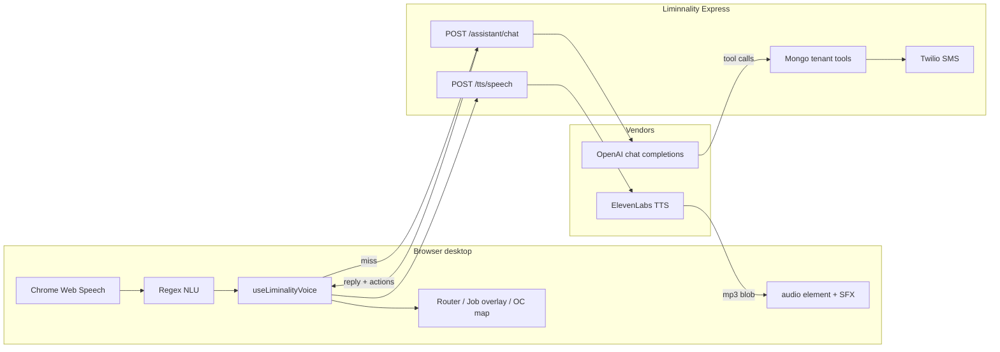

# Liminality voice — how it is built

Shop-floor voice assistant for Liminnality (San Clemente Woodworking ops). Desktop only. The user wakes it by name, speaks a command, and it either jumps to a screen or asks the in-app assistant for live shop data, then talks back.

This note is the current stack, the request path, and where time is spent — so another model can propose faster or simpler options.

---

## What a turn does

```
mic (Chrome Web Speech)
    → local regex / keyword NLU (wake, nav, send, close)
    → if that misses: POST /assistant/chat  (OpenAI + tools + Mongo)
    → client actions (navigate / open job / map tour)
    → POST /tts/speech  (ElevenLabs MP3 blob)
    → play full clip in <audio>
```

TTS now streams PCM from ElevenLabs so playback can start before the full sentence is ready. STT is still Chrome Web Speech (not streaming to our server). The assistant still uses Chat Completions; voice map/nav/deposit/payment/SMS answers skip the extra model round when the tool result is enough.

---

## Code map

| Layer | Path | Role |
| --- | --- | --- |
| Runtime host | `frontend/src/components/voice/LiminalityRuntime.tsx` | Mounts the hook, wires `navigate`. Renders nothing. Off on mobile. |
| State machine | `frontend/src/hooks/useLiminalityVoice.ts` | Wake → 30s listen → process → speak. Keyboard/mouse cancels mid-speech. |
| Local NLU | `frontend/src/voice/liminalityCommands.ts` | Wake words, cancel/close, screen keywords, “send X to Y” regex. |
| Assistant client | `frontend/src/voice/assistantVoice.ts` | `POST /assistant/chat` with `{ messages, voice: true, pagePath }`. Parses `actions`. |
| TTS client | `frontend/src/voice/neuralSpeech.ts` | `POST /tts/speech` as a blob. In-memory clip cache (80). Prefetch canned lines. |
| Browser STT | `frontend/src/voice/browserSpeech.ts` | `webkitSpeechRecognition`, continuous + interim. |
| SFX | `frontend/src/voice/listeningCue.ts` | Start clip `0:00–1.99`, close clip `8:00–8.99`. |
| Job overlay | `frontend/src/voice/jobOverlayBus.ts` + `JobOverlayHost.tsx` | Open job card on current page, Files tab. |
| Map tour | `frontend/src/voice/mapCommandBus.ts` | Filter pins, highlight one job, speak that line, next. |
| Chat UI (same brain) | `frontend/src/components/assistant/SiteAssistantChat.tsx` | Typed help uses the same `/assistant/chat` without `voice: true`. |
| Assistant API | `backend/src/controllers/assistantController.js` | OpenAI Chat Completions + tool loop (max 8 rounds). |
| Shop data tools | `backend/src/services/assistantDataService.js` | Payments, deposits, jobs, map, calendar, SMS. |
| TTS API | `backend/src/controllers/ttsController.js` | ElevenLabs `text-to-speech`. OpenAI TTS helpers exist but are not the live path. |

Auth: both `/assistant` and `/tts` sit behind `requireAuth` (`backend/src/routes/assistant.js`, `backend/src/routes/tts.js`). Mounted at `/assistant` and `/api/assistant`, `/tts` and `/api/tts`.

Settings: `localStorage` keys `paarth.liminality.enabled` and `paarth.liminality.voiceUri` (`frontend/src/voice/liminalitySettings.ts`).

---

## APIs

### 1. Speech-to-text — Chrome Web Speech (client)

- `window.SpeechRecognition` / `webkitSpeechRecognition`
- `lang: en-US`, `continuous: true`, `interimResults: true`
- No API key. Runs in the browser. Chrome / Edge desktop.
- Endpoint delay for a command: **900 ms** after interim text (`COMMAND_ENDPOINT_MS`).
- Mic is **stopped while she talks** so her own TTS is not transcribed as a new command.

This is the weakest, cheapest, and least controllable piece. No model choice, no custom vocab (job names / “Liminality”), no on-prem option.

### 2. Language / tools — OpenAI Chat Completions (server)

```
POST https://api.openai.com/v1/chat/completions
Authorization: Bearer OPENAI_API_KEY
model: process.env.OPENAI_MODEL || gpt-4o-mini
temperature: 0.25 (voice) / 0.4 (typed chat)
tools: OpenAI function-calling, tool_choice auto
max tool rounds: 8
```

Env: `OPENAI_API_KEY`, optional `OPENAI_MODEL`.

Voice client sends the last **8** turns. Server keeps up to **24** sanitized messages. Each tool call is a new Completions request in a `while` loop until the model returns plain text.

**Tools the model can call**

| Tool | What it hits |
| --- | --- |
| `global_search` | Same tenant search as the header bar |
| `get_recent_payments` | `payment_received` activities |
| `get_recent_deposits` | Paid deposit lines, CRM deposits, linked bank |
| `search_job_notes` | Job notes + crew notes |
| `get_job_details` | One job (voice also opens the card) |
| `open_job_card` | Client overlay, Files tab |
| `navigate_user` | Whitelisted in-app path |
| `search_jobs` | Text list by city / name |
| `show_jobs_on_map` | Filter OC map; `near` = 10-mile radius |
| `get_upcoming_schedule` | Calendar + dated jobs |
| `list_sms_employees` | Rolodex mobiles |
| `send_customer_info_text` | Twilio customer card to one employee |
| `get_current_user_context` | Name / role |

Client actions returned with the reply:

- `{ type: 'navigate', path }`
- `{ type: 'open_job', jobId, tab }`
- `{ type: 'map_show', path, filters, jobIds, jobs }`

Voice system prompt asks for **one short sentence**. For map tours it should only say the count and place; the client names each job while highlighting the pin.

### 3. Text-to-speech — ElevenLabs (server → client blob)

```
POST https://api.elevenlabs.io/v1/text-to-speech/{voiceId}
  ?output_format=mp3_44100_64
  &optimize_streaming_latency=4

xi-api-key: ELEVENLABS_API_KEY
model chain: ELEVENLABS_TTS_MODEL || eleven_flash_v2_5
             then eleven_turbo_v2_5, eleven_multilingual_v2
```

Liminnality wraps that as:

```
POST /tts/speech
{ text, voice: "eleven:sarah", tone: "polite" | "candid" }
→ audio/mpeg  (full file, not a stream)
```

Voices (URI `eleven:<name>`): Sarah (default), Adam, Jessa, Victor, Carla, Natasha, Kaori, Sakura, Cassius.

Client caches MP3 blobs in memory (key = voice + tone + text, max 80) and prefetches canned nav / wake lines. **Assistant answers are not streamed and are not prefetched** — first speak waits for the whole MP3.

OpenAI `gpt-4o-mini-tts` / `tts-1-hd` code exists in `ttsController.js` but `synthesizeSpeech` currently requires ElevenLabs and does not fall through to OpenAI.

---

## Local NLP (no model)

This layer runs in the browser **before** OpenAI. It is regex + keyword sets, not an embedding classifier.

**Wake**

- Name: `liminality`, `liminnality`, `liminal`, STT mangles like `lemon ality`
- Spoken replies stay short and professional

**Listen window:** 30 seconds from wake (`COMMAND_TIMEOUT_MS`). Start SFX on wake, close SFX when the window ends.

**Hard commands (no OpenAI)**

- Screens: pipeline / calendar / customers / dashboard (one keyword match, ≤4 tokens unless “open/go to…”)
- Cancel: stop, never mind, cancel, goodbye, thanks, …
- Close work: close / close it / shut it — dismisses job overlay + map tour, stays listening
- Pointer or key while she is talking: same dismiss
- Send: `send Hammer to Jake` parsed locally, then the assistant tool actually texts

Anything else (questions, deposits, “jobs in San Clemente”, “open the Stickel job”) goes to OpenAI.

There is no intent classifier, no slot-filling library, no speech endpointing model.

---

## Runtime phases

```
off → waiting (wake listen)
    → listening (30s command window)
    → processing (local match or /assistant/chat)
    → executing (navigate / overlay / map)
    → speaking (ElevenLabs clip)
    → listening again until the 30s clock runs out
    → waiting + close SFX
```

Interrupt: `cancelSpeech()` aborts the in-flight TTS fetch/play, `abortMapTour()` resets the map, `closeJobOverlay()` closes the card.

---

## Architecture



Frontend: React 19, Vite, TypeScript, MUI, React Router.  
Backend: Express 5, Mongoose, tenant-scoped Mongo.  
Hosted today as a Vite frontend + Render API (`paarth-api.onrender.com`).

---

## Latency — where it is slow

Typical “jobs in San Clemente” path:

1. Chrome STT + 900 ms endpoint ≈ 1–2 s after they stop talking
2. `POST /assistant/chat` → OpenAI round 1 (pick `show_jobs_on_map`)
3. Mongo `showJobsOnMap`
4. OpenAI round 2 (one-sentence reply)
5. Client navigates to dashboard, map paints, then **for each job**:
   - `POST /tts/speech` (unless cached)
   - wait for full MP3
   - play it
   - next pin

Bottlenecks, in order of pain:

1. **STT is still Chrome cloud speech** with no custom lexicon. Wake name and customer names garble.
2. **Assistant Completions is still used for open-ended questions.** Map “in/near” and several tool replies no longer wait for a second model pass.
3. **TTS streams PCM now** (ElevenLabs `/stream`, `pcm_24000`). Cached canned lines still play as MP3 blobs.
3. **STT is Chrome cloud speech with no custom lexicon.** Wake name and customer names garble. 900 ms hang after they finish.
4. **Mic cannot barge in.** We mute during TTS because echo used to re-run the last map command. Interrupt is click/key or “close” after she stops.
5. **No on-device or WebRTC voice session.** Every turn is HTTP request/response.

What is already cheap: local nav keywords, clip cache for “Opening pipeline.”, Flash v2.5 + `optimize_streaming_latency=4`.

---

## Product constraints to keep

- Desktop / kiosk, not phone layout
- Short answers. No feelings, no “I know you’re upset”
- Live tenant data only — never invent payments or customers
- Job card opens in place on Files; do not bounce to pipeline
- Map: **in** city = exact city; **near** city = 10 miles
- Do not print shop or financial PINs
- Voice stays off on the mobile layout

---

## Paste this into ChatGPT

Use the doc above plus:

> Here is how Liminality voice works in Liminnality today (see liminalVoice.md).
>
> I want options that are **faster** and **more reliable** than:
> Chrome Web Speech → regex → OpenAI gpt-4o-mini tool loop → ElevenLabs full MP3 blob.
>
> Constraints: React/Vite desktop web app, Express/Mongo backend, must stay in the browser (no native app), must keep tool access to our shop data, short spoken answers, barge-in if possible.
>
> Please compare, with rough latency and cost:
> 1. Keep this architecture but stream TTS / stream the assistant
> 2. OpenAI Realtime or WebRTC voice (audio in + audio out, tools still on our server)
> 3. Deepgram / AssemblyAI / Whisper streaming STT instead of Chrome
> 4. Cheaper/faster TTS (OpenAI streaming TTS, Cartesia, local)
> 5. Push more intents off the LLM (classifier or grammar) so map/nav/close never wait on OpenAI
>
> Rank by: time-to-first-audio, barge-in, wake-word accuracy, implementation effort on this repo, monthly cost at shop-floor volume (tens of commands per hour, not a call center).
>
> Tell me what to change first for the biggest speed win with the least rewrite.
